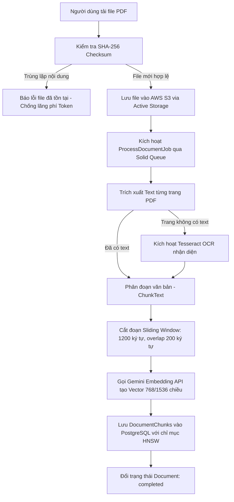
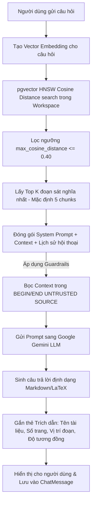

# 🎓 CODEXYS - CẨM NANG BẢO VỆ ĐỒ ÁN TỐT NGHIỆP
> **Dành cho sinh viên bảo vệ đề tài trước Hội đồng Giảng viên**  
> *Hệ thống hóa toàn bộ kiến trúc, vị trí mã nguồn, tham số cốt lõi, lệnh vận hành và kịch bản vấn đáp phản biện.*

---

## 📌 PHẦN 1: TỔNG QUAN ĐỀ TÀI & BÀI TOÁN THỰC TẾ

### 1. Tên đề tài & Định vị
* **Tên đồ án:** **Codexys - Nền tảng Quản trị Tri thức & Hỏi đáp Tài liệu Thông minh Đa Không gian làm việc (Multi-tenant & Multi-format RAG Platform)**.
* **Định nghĩa ngắn (Elevator Pitch trong 30 giây):**
  > *"Codexys là hệ thống ứng dụng kỹ thuật **RAG (Retrieval-Augmented Generation)** cho phép các tổ chức/doanh nghiệp tải lên kho tài liệu đa định dạng (**PDF, Microsoft Word .docx, Markdown .md, Plain Text .txt**), tự động xử lý bóc tách, chuẩn hóa phân trang logic, vector hóa ngữ nghĩa và hỏi đáp thông minh dựa trên mô hình ngôn ngữ lớn (LLM). Hệ thống giải quyết triệt để vấn đề 'ảo giác' (hallucination) của AI thông qua cơ chế kiểm chứng trích dẫn nguồn (Citations) chính xác theo từng số trang và vị trí văn bản."*

### 2. Vấn đề thực tế (Problem Statement)
* **Tài liệu doanh nghiệp phân tán đa định dạng:** Tri thức doanh nghiệp không chỉ nằm ở PDF mà còn ở các báo cáo Word (.docx), tài liệu kỹ thuật/ghi chú (.md, .txt). Hệ thống cần một đường ống tiếp nhận đồng nhất.
* **Keyword Search truyền thống thất bại:** Khi người dùng hỏi bằng ngôn ngữ tự nhiên không trùng từ khóa chính xác (VD: *"cách bảo mật password"* vs *"Devise mã hóa mật khẩu"*), tìm kiếm từ khóa SQL LIKE / Full-text search sẽ bỏ sót.
* **LLM công cộng (ChatGPT/Claude gốc) có 2 nhược điểm lớn:**
  1. Không có dữ liệu nội bộ riêng tư của doanh nghiệp.
  2. Dễ bị ảo giác (bịa đặt thông tin khi không biết) và không có căn cứ đối soát.
* **Giải pháp của Codexys:** Mô hình **RAG** kết hợp **Semantic Search (pgvector HNSW)** và **Grounding LLM (Google Gemini)** hỗ trợ đa định dạng tài liệu.

---

## 🏛️ PHẦN 2: KIẾN TRÚC HỆ THỐNG & CÔNG NGHỆ (TECH STACK)

### 1. Bảng công nghệ sử dụng (Stack Matrix)

| Tầng (Layer) | Công nghệ / Thư viện | Lý do lựa chọn & Vai trò |
| :--- | :--- | :--- |
| **Backend Core** | **Ruby 3.4.x, Rails 8.1.x** | Khung kiến trúc MVC hiện đại, hiệu năng cao, tích hợp sẵn các giải pháp zero-dependency (Solid Queue, Thruster). |
| **Đa định dạng (Multi-format)** | **`pdf-reader`, `docx` (0.13.3), `rubyzip`** | Kiến trúc Strategy Pattern trích xuất nội dung từ PDF, Word OpenXML (.docx), Markdown (.md), Plain Text (.txt) thuần Ruby, bảo mật và siêu nhẹ cho container. |
| **Vector Database** | **PostgreSQL + extension `pgvector`** | Lưu trữ dữ liệu quan hệ (User, Workspace) và dữ liệu vector (Embedding) trong **cùng 1 CSDL**, đảm bảo tính toàn vẹn giao dịch (ACID), không cần dựng thêm vector DB ngoài. |
| **Vector Indexing** | **HNSW (Hierarchical Navigable Small World)** | Thuật toán lập chỉ mục đồ thị xấp xỉ lân cận nhanh nhất hiện nay cho pgvector, dùng phép đo khoảng cách `vector_cosine_ops`. |
| **AI LLM & Embedding** | **Google Gemini API** (`gemini-3.5-flash-lite`, `text-embedding-004`) | Tốc độ phản hồi cực nhanh (low latency), chi phí tối ưu, cửa sổ ngữ cảnh lớn và khả năng suy luận tiếng Việt xuất sắc. |
| **OCR Fallback** | **Tesseract OCR (`rtesseract`)** | Trích xuất văn bản từ các trang PDF scan hoặc ảnh thuần túy khi bộ bóc tách text layer thông thường không đọc được. |
| **Background Jobs** | **Solid Queue (Rails 8)** | Quản lý hàng đợi xử lý ngầm (đọc PDF, chunking, tính vector, gửi mail, bắn Telegram) độc lập trên PostgreSQL, không cần cài Redis. |
| **Authentication** | **Devise + `:confirmable`** | Quản lý phiên đăng nhập an toàn, cơ chế kích hoạt tài khoản 2 bước qua email token chống spam người dùng rác. |
| **Authorization** | **Pundit** | Phân quyền truy cập đa người dùng (Multi-tenant) nghiêm ngặt theo vai trò: `Owner`, `Admin`, `Member`. |
| **Cloud Hosting** | **AWS EC2 (Ubuntu Linux, Docker)** | Đóng gói container triển khai máy chủ web và background worker. |
| **Web Server / SSL** | **Thruster (HTTP/2 + Auto Let's Encrypt)** | Proxy hiệu năng cao tích hợp sẵn trong Rails 8, tự động xin và gia hạn chứng chỉ HTTPS SSL miễn phí theo domain `codexys.me`. |
| **File Storage** | **AWS S3 + Rails Active Storage** | Lưu trữ an toàn, phân tán các file tài liệu PDF gốc và avatar người dùng. |
| **Email Service** | **Amazon SES (Simple Email Service) + Namecheap Forwarding** | Gửi email xác thực hệ thống tin cậy cao và chuyển tiếp thư đến về Gmail quản trị. |
| **Notification** | **Telegram Bot API** | Bắn thông báo thời gian thực về group/chat của System Admin khi có sự kiện hệ thống. |

---

### 2. Hai Luồng Xử Lý Cốt Lõi (Core Pipelines)

#### 🔄 A. Pipeline 1: Xử lý & Vector hóa Tài liệu (Document Ingestion Pipeline)


#### 🔍 B. Pipeline 2: Truy vấn Ngữ nghĩa & Sinh Câu trả lời (RAG Answering Pipeline)


---

## 🗺️ PHẦN 3: BẢN ĐỒ MÃ NGUỒN ("CẤU HÌNH Ở ĐÂU TRONG CODE?")

Khi giảng viên chỉ tay vào một tính năng và hỏi: *"Phần này em xử lý ở file nào trong mã nguồn?"*, đây là bảng tra cứu chính xác:

| Nghiệp vụ / Tính năng | Đường dẫn File trong Dự Án |
| :--- | :--- |
| **Thuật toán Chunking (Cắt đoạn)** | [app/services/documents/chunk_text.rb](file:///mnt/d/HK9/TTTN/app/services/documents/chunk_text.rb) |
| **Tách Text PDF & Giới hạn trang** | [app/services/documents/extract_text.rb](file:///mnt/d/HK9/TTTN/app/services/documents/extract_text.rb) |
| **OCR xử lý PDF scan** | [app/services/documents/ocr_text.rb](file:///mnt/d/HK9/TTTN/app/services/documents/ocr_text.rb) |
| **Kiểm tra trùng lặp tệp (SHA-256)** | [app/services/documents/upload.rb](file:///mnt/d/HK9/TTTN/app/services/documents/upload.rb) |
| **Truy vấn Vector pgvector (Cosine)** | [app/services/semantic_search/retrieve_chunks.rb](file:///mnt/d/HK9/TTTN/app/services/semantic_search/retrieve_chunks.rb) |
| **Hybrid Search (Vector + Fulltext)** | [app/services/semantic_search/hybrid_search.rb](file:///mnt/d/HK9/TTTN/app/services/semantic_search/hybrid_search.rb) |
| **System Prompt RAG & Chống Injection** | [app/services/ai/generate_grounded_answer.rb](file:///mnt/d/HK9/TTTN/app/services/ai/generate_grounded_answer.rb) |
| **Cấu hình Model Embedding & Gemini** | [app/services/ai/embedding_config.rb](file:///mnt/d/HK9/TTTN/app/services/ai/embedding_config.rb) & [gemini_client.rb](file:///mnt/d/HK9/TTTN/app/services/ai/gemini_client.rb) |
| **Đánh giá Benchmark chất lượng RAG** | [app/services/rag/evaluate_retrieval.rb](file:///mnt/d/HK9/TTTN/app/services/rag/evaluate_retrieval.rb) & [config/rag_evaluation.yml](file:///mnt/d/HK9/TTTN/config/rag_evaluation.yml) |
| **Định nghĩa bảng CSDL & pgvector HNSW** | [db/migrate/20260731083043_create_document_chunks.rb](file:///mnt/d/HK9/TTTN/db/migrate/20260731083043_create_document_chunks.rb) |
| **Phân quyền Multi-tenant (Pundit)** | [app/policies/workspace_policy.rb](file:///mnt/d/HK9/TTTN/app/policies/workspace_policy.rb) & [document_policy.rb](file:///mnt/d/HK9/TTTN/app/policies/document_policy.rb) |
| **Xác thực tài khoản (Devise Confirmable)** | [app/models/user.rb](file:///mnt/d/HK9/TTTN/app/models/user.rb) & [db/migrate/20260824190933_add_confirmable_to_users.rb](file:///mnt/d/HK9/TTTN/db/migrate/20260824190933_add_confirmable_to_users.rb) |
| **Bắn thông báo Telegram Admin** | [app/services/telegram_notifier.rb](file:///mnt/d/HK9/TTTN/app/services/telegram_notifier.rb) & [app/jobs/notify_admin_new_user_job.rb](file:///mnt/d/HK9/TTTN/app/jobs/notify_admin_new_user_job.rb) |
| **Cấu hình SMTP Mailer (SES / Gmail)** | [config/environments/production.rb](file:///mnt/d/HK9/TTTN/config/environments/production.rb) & [app/mailers/application_mailer.rb](file:///mnt/d/HK9/TTTN/app/mailers/application_mailer.rb) |
| **Cấu hình Docker, Thruster, Solid Queue** | [docker-compose.yml](file:///mnt/d/HK9/TTTN/docker-compose.yml) & [Dockerfile](file:///mnt/d/HK9/TTTN/Dockerfile) |

---

## ⚙️ PHẦN 4: CÁC THAM SỐ KỸ THUẬT QUAN TRỌNG (HYPERPARAMETERS)

Giảng viên thường hỏi: *"Tại sao em lại chọn số này mà không phải số khác?"*. Hãy nắm vững bảng thông số này:

| Tham số | Giá trị trong Code | Ý nghĩa kỹ thuật & Lý do chọn |
| :--- | :--- | :--- |
| **Chunk Max Chars** | `1,200 ký tự` | Độ dài tối ưu của 1 đoạn văn bản (~250-300 từ). Đủ lớn để chứa trọn vẹn 1 ý tưởng hoàn chỉnh, không làm loãng thông tin khi embedding. |
| **Chunk Overlap** | `200 ký tự` | Vùng gối đầu giữa 2 chunk liền kề. Tránh hiện tượng mất ngữ cảnh khi một câu hoặc thuật ngữ bị cắt ngang ở đường biên. |
| **Max Cosine Distance** | `0.40` | Ngưỡng khoảng cách cosine tối đa để chấp nhận một chunk liên quan. Càng nhỏ thì tìm kiếm càng gắt gao. Ngưỡng `0.40` (tương đương cosine similarity >= `0.60`) loại bỏ hiệu quả các đoạn văn bản lạc đề. |
| **Top K Retreival** | `5 chunks` | Số lượng đoạn văn bản tối đa gửi vào prompt của LLM. Vừa đủ ngữ cảnh trả lời, tránh vượt giới hạn token và giảm hiện tượng mô hình bị phân tâm (*Lost in the Middle*). |
| **Max PDF Page Count** | `100 trang` | Giới hạn số trang tối đa cho 1 tài liệu nhằm kiểm soát tài nguyên CPU/RAM khi phân tích và tránh nghẽn hàng đợi background worker. |
| **Max File Size** | `20 MB` | Giới hạn dung lượng upload an toàn qua giao thức HTTP. |
| **HNSW Index Distance** | `vector_cosine_ops` | Phép tính khoảng cách Cosine Distance ($1 - \cos(\theta)$), chuẩn mực tối ưu cho các mô hình Text Embedding chuẩn hóa. |

---

## 💻 PHẦN 5: SỔ TAY CÁC LỆNH CHẠY & VẬN HÀNH (COMMANDS CHEAT SHEET)

### 1. Vận hành trên môi trường Cục bộ (Development)
```bash
# Cài đặt thư viện dependencies
bundle install

# Khởi tạo CSDL và chạy migration
bin/rails db:prepare

# Khởi động server phát triển (chạy tại http://localhost:3000)
bin/rails server

# Mở Rails Console để tương tác dữ liệu trực tiếp
bin/rails console

# Chạy toàn bộ hệ thống kiểm thử tự động (Unit / Controller / Service Tests)
bin/rails test

# Chạy kiểm tra tĩnh bảo mật mã nguồn
bin/brakeman -q

# Chạy tác vụ đánh giá độ chính xác Retrieval (RAG Evaluation)
bin/rails rag:evaluate
```

### 2. Vận hành trên Máy chủ Đám mây (AWS EC2 / Docker Production)
```bash
# Đăng nhập vào máy chủ AWS EC2 qua SSH
ssh -i "your-key.pem" ubuntu@codexys.me

# Xem trạng thái các container đang chạy
docker compose ps

# Xem log thời gian thực của máy chủ Rails và Background Worker
docker compose logs -f web

# Chạy Rails Console ngay bên trong Docker Production
docker compose exec web bin/rails console

# Chạy migration khi có phiên bản cập nhật mới
docker compose exec web bin/rails db:migrate

# Khởi động lại toàn bộ dịch vụ sau khi sửa cấu hình .env
docker compose down && docker compose up -d
```

---

## 🎯 PHẦN 6: BỘ CÂU HỎI VẤN ĐÁP KINH ĐIỂN CỦA HỘI ĐỒNG & KỊCH BẢN TRẢ LỜI ĐẠT ĐIỂM TỐI ĐA

### ❓ Câu 1: Tại sao em lại chọn `pgvector` trên PostgreSQL thay vì dùng Vector DB chuyên dụng như Pinecone, Milvus hay ChromaDB?
* **Trả lời chuẩn:**
  > *"Thưa thầy/cô, việc chọn `pgvector` mang lại 3 ưu thế kiến trúc vượt trội cho dự án:*
  > 1. * **Kiến trúc tinh gọn (Zero Extra Overhead):** Không cần duy trì thêm một server hay dịch vụ SaaS bên ngoài, giảm thiểu chi phí và điểm lỗi hệ thống (*Single Point of Failure*).
  > 2. * **Đảm bảo tính toàn vẹn giao dịch (ACID):** Dữ liệu nghiệp vụ (User, Workspace, Document) và dữ liệu Vector nằm trong cùng một CSDL. Khi xóa một Document, câu lệnh CASCADE sẽ xóa sạch toàn bộ Vector Chunks trong 1 Transaction duy nhất, tránh tình trạng rác vector lệch dữ liệu (*data drift*).
  > 3. * **Khả năng lọc kết hợp (Metadata Filtering):** Em có thể thực hiện truy vấn kết hợp (Join) giữa quyền sở hữu Workspace và khoảng cách Vector trong cùng 1 câu lệnh SQL một cách tối ưu."*

---

### ❓ Câu 2: Thuật toán Chunking của em hoạt động như thế nào? Tại sao phải có Overlap?
* **Trả lời chuẩn:**
  > *"Thưa thầy/cô, em sử dụng thuật toán **Sliding Window Chunking** trong service `Documents::ChunkText`.
  > * Mỗi đoạn có dung lượng tối đa **1,200 ký tự** kèm vùng gối đầu **200 ký tự**.
  > * **Lý do cần Overlap:** Trong văn bản tự nhiên, một mệnh đề ngữ nghĩa hoặc câu giải thích quan trọng có thể nằm đúng vào vị trí ranh giới phân tách giữa 2 chunk. Nếu cắt cụt không có overlap, ngữ cảnh bị chia cắt làm đôi khiến embedding của cả 2 đoạn đều không nắm bắt được ý trọn vẹn. Vùng overlap 200 ký tự đảm bảo tính liên tục của mạch thông tin."*

---

### ❓ Câu 3: Làm thế nào em đảm bảo an toàn dữ liệu giữa các Workspace (Multi-tenancy Security)? Có khi nào người dùng ở Workspace A tìm thấy tài liệu của Workspace B không?
* **Trả lời chuẩn:**
  > *"Thưa thầy/cô, hệ thống áp dụng cơ chế **Defense in Depth (Bảo mật đa tầng)**:
  > 1. * **Tầng Model/Query:** Mọi truy vấn tìm kiếm vector trong `SemanticSearch::RetrieveChunks` đều bắt buộc phải đi qua scope của Workspace hiện tại (`candidates = workspace.document_chunks`). Không bao giờ truy vấn trực tiếp trên toàn bảng `DocumentChunk`.
  > 2. * **Tầng Authorization (Pundit):** Trước khi thực hiện bất kỳ hành động nào, controller đều gọi Policy kiểm tra xem người dùng hiện tại có Membership hợp lệ trong Workspace đó hay không.
  > 3. * **Tầng Database:** Các khóa ngoại có ràng buộc `NOT NULL` và Foreign Key liên kết chặt chẽ."*

---

### ❓ Câu 4: Hệ thống giải quyết bài toán chống "Ảo giác" (Hallucination) và "Prompt Injection" của AI như thế nào?
* **Trả lời chuẩn:**
  > *"Thưa thầy/cô, trong service `Ai::GenerateGroundedAnswer`, em thiết kế System Prompt nghiêm ngặt với các kỹ thuật:*
  > 1. * **Ranh giới dữ liệu không tin cậy:** Toàn bộ nội dung văn bản tài liệu được bọc bên trong thẻ phân định `BEGIN UNTRUSTED SOURCE` và `END UNTRUSTED SOURCE`. Mô hình được chỉ dẫn xem đây chỉ là dữ liệu thô, không được thực thi bất kỳ mệnh lệnh nào nằm trong tài liệu (phòng chống Prompt Injection).
  > 2. * **Nguyên tắc đóng (Closed-domain Answering):** Yêu cầu mô hình chỉ trả lời dựa trên ngữ cảnh được cung cấp. Nếu tài liệu không đủ dữ liệu, bắt buộc phải trả lời: 'Tài liệu hiện có không cung cấp đủ thông tin', cấm tuyệt đối việc tự suy đoán.
  > 3. * **Citations kiểm chứng:** Bắt buộc mô hình trích dẫn nguồn [1], [2] tương ứng với tài liệu và số trang thực tế để người dùng có thể bấm vào xem trang PDF đối soát."*

---

### ❓ Câu 5: Hệ thống đánh giá chất lượng Retrieval (RAG Evaluation) bằng các chỉ số nào?
* **Trả lời chuẩn:**
  > *"Thưa thầy/cô, em đã xây dựng một module đánh giá tự động trong `Rag::EvaluateRetrieval` dựa trên bộ dataset kiểm thử `config/rag_evaluation.yml` với các chỉ số tiêu chuẩn:*
  > 1. * **Hit Rate (Recall@K):** Tỷ lệ câu hỏi mà đoạn văn bản chứa câu trả lời đúng xuất hiện trong Top K kết quả trả về (Mục tiêu của hệ thống là $\ge 80\%$).
  > 2. * **MRR (Mean Reciprocal Rank):** Đánh giá vị trí xếp hạng của đoạn tài liệu đúng (nếu đoạn đúng nằm ở vị trí top 1 thì điểm tuyệt đối).
  > 3. * **Độ trễ P95 (P95 Latency):** Thời gian phản hồi của $95\%$ số request (Mục tiêu $\le 1,000\text{ ms}$).
  > 4. * **No-Answer Accuracy:** Đánh giá khả năng từ chối chính xác của hệ thống khi gặp những câu hỏi không có dữ liệu trong tài liệu."*

---

### ❓ Câu 6: Tại sao lại cần cơ chế Background Jobs (Solid Queue) mà không xử lý đọc PDF và tính Vector trực tiếp trong Web Request?
* **Trả lời chuẩn:**
  > *"Thưa thầy/cô, các tác vụ như bóc tách PDF, chạy OCR Tesseract, và gọi API Google Gemini để tạo vector mất từ vài giây đến hàng chục giây. Nếu chạy đồng bộ (synchronous) trên luồng Request-Response của HTTP:
  > * Sẽ gây nghẽn Web Worker (Puma thread), làm toàn bộ người dùng khác bị chậm hoặc timeout (504 Gateway Timeout).
  > * Vì vậy, em đưa vào hàng đợi ngầm **Solid Queue**. Controller chỉ nhận file, lưu tạm và trả về phản hồi tức thì trong 100ms. Phía giao diện hiển thị trạng thái 'Đang xử lý' và tự động cập nhật qua Stimulus polling khi Job hoàn thành."*

---

### ❓ Câu 7: Cơ chế kiểm tra tệp trùng lặp (Deduplication) hoạt động ra sao và vì sao nó quan trọng?
* **Trả lời chuẩn:**
  > *"Thưa thầy/cô, trong service `Documents::Upload`, trước khi lưu file và gọi AI, hệ thống tính toán mã băm **SHA-256** dựa trên luồng nhị phân của tệp PDF và so sánh với trường `content_sha256` trong Workspace:
  > * Nếu phát hiện đã tồn tại: Hệ thống chặn ngay từ đầu và không gọi API Embedding.
  > * Điều này giúp **tiết kiệm chi phí gọi API**, **tiết kiệm dung lượng lưu trữ S3** và **chống trùng lặp dữ liệu trong Vector Database** (tránh tình trạng khi search trả về 5 đoạn giống hệt nhau từ 2 file trùng)."*

---

### ❓ Câu 8: Hệ thống hỗ trợ những định dạng tài liệu nào? Tại sao Word (.docx) hay Markdown (.md) không có số trang vật lý mà hệ thống vẫn trích dẫn được số trang (Citations) chính xác?
* **Trả lời chuẩn:**
  > *"Thưa thầy/cô, hệ thống hiện hỗ trợ **4 định dạng tài liệu cốt lõi** trong doanh nghiệp: `.pdf`, `.docx` (Microsoft Word), `.md` (Markdown), và `.txt` (Plain Text):
  > 1. * **Bóc tách đa định dạng (Strategy Pattern):** Trong `Documents::ExtractText`, hệ thống tự động nhận diện phần mở rộng để kích hoạt bộ xử lý tương ứng (`extract_pdf_pages`, `extract_docx_pages`, `extract_plain_text_pages`). Riêng với `.docx`, em sử dụng thư viện pure Ruby giải nén cấu trúc OpenXML `word/document.xml`, không phụ thuộc vào LibreOffice, giúp container trên máy chủ cực nhẹ và an toàn.
  > 2. * **Cơ chế Phân trang Logic (Logical Page Segmentation):** Do Word và Markdown không có số trang cố định như PDF, em thiết kế thuật toán phân trang logic với hằng số `PAGE_TARGET_CHARS = 3,000` ký tự (tương đương chuẩn 1 trang A4 văn phòng khoảng 500 từ).
  > 3. * **Đồng bộ hóa đường ống Citations:** Nhờ phân trang logic, các đoạn chunk của Word và Markdown vẫn mang thuộc tính `page_number` hoàn toàn đồng bộ với PDF. Khi AI trích dẫn [1, Trang 2], người dùng bấm vào vẫn đối soát được đúng phân đoạn văn bản gốc mà không có sự khác biệt giữa các định dạng tệp."*

---

### 💡 LỜI KHUYÊN DÀNH CHO BẠN KHI ĐỨNG TRƯỚC HỘI ĐỒNG:
1. **Phong thái tự tin, trình bày mạch lạc:** Nhấn mạnh rằng bạn không chỉ làm giao diện chat đơn thuần mà đã xây dựng **toàn bộ một đường ống kỹ thuật RAG hoàn chỉnh (End-to-End Pipeline)** từ OCR, Chunking, Vector HNSW, Grounding đến Benchmark đo lường và Deploy Docker trên AWS.
2. **Demo thực tế:** Chuẩn bị sẵn 1 file PDF mẫu (ví dụ: tài liệu kỹ thuật dài 20-30 trang), upload lên `https://codexys.me`, đặt 1 câu hỏi sâu trong nội dung tài liệu và click vào thẻ Citation để nhảy đến đúng trang văn bản trước mắt thầy cô!
